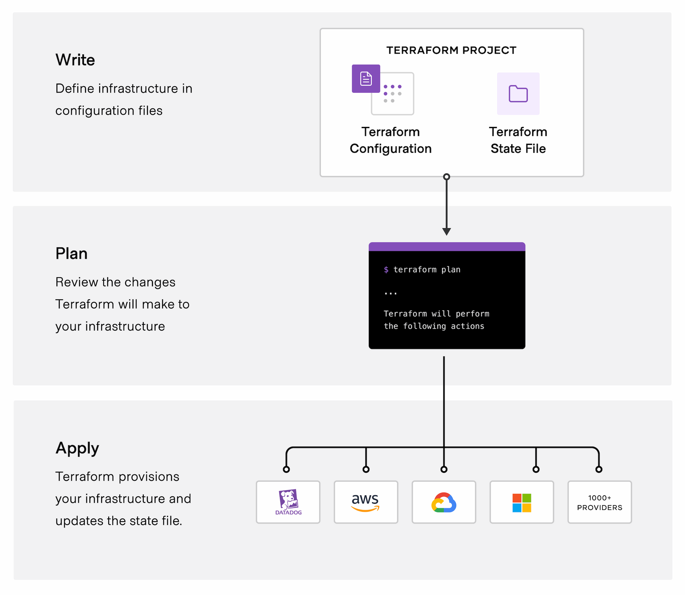

# Introduction to Terraform

Terraform is an **Infrastructure as Code (IaC)** tool developed by HashiCorp. It allows engineers to create, update, and manage cloud and on-premises infrastructure using human-readable configuration files.

Terraform helps automate infrastructure provisioning, maintain consistency, track changes through version control, and manage resources across multiple platforms, including AWS, Azure, Google Cloud, and Kubernetes.

**Official Documentation:** [Terraform Documentation](https://developer.hashicorp.com/terraform)

---

# How Does Terraform Work?

## 1. What Is Terraform?

Terraform is an Infrastructure as Code (IaC) tool. It lets you create, change, and manage infrastructure by writing configuration files instead of setting everything up manually.

For example, Terraform can help you create:

* Virtual machines
* Networks and firewalls
* Storage accounts
* Kubernetes clusters
* Databases
* Cloud resources on AWS, Azure, and Google Cloud

Think of Terraform as a tool that reads your infrastructure instructions and carries them out for you.

## 2. How Does Terraform Communicate with Cloud Platforms?

Terraform communicates with cloud platforms and other services through their **APIs (Application Programming Interfaces)**.

An API allows one software application to request information or actions from another application.

Terraform uses **providers** to communicate with specific platforms and services. A provider is a plugin that translates Terraform's instructions into requests that the platform understands.

For example:

1. You write Terraform configuration to create an Azure virtual machine.
2. The Azure provider sends the necessary requests to Azure through its API.
3. Azure creates the virtual machine.
4. Terraform records information about the managed resource in its state.

### How Terraform Works

```text
Terraform Configuration (.tf files)
                 |
                 v
             Terraform
                 |
                 v
        Azure Provider Plugin
                 |
                 v
             Azure API
                 |
                 v
      Azure Virtual Machine Created
```

Terraform supports many platforms and services, including AWS, Azure, Google Cloud, Kubernetes, GitHub, and many others.

Browse available providers in the [Terraform Registry](https://registry.terraform.io/browse/providers).

## 3. The Three Main Terraform Workflow Stages

The usual Terraform workflow has three main stages: **Write, Plan, and Apply**.

### Stage 1: Write

Write the desired infrastructure in Terraform configuration files. These files usually use the `.tf` extension and are written in HashiCorp Configuration Language (HCL).

For example, this configuration declares an Azure resource group:

```hcl
provider "azurerm" {
  features {}
}

resource "azurerm_resource_group" "example" {
  name     = "example-resources"
  location = "East US"
}
```

**Explanation:**

* `provider "azurerm"` tells Terraform to use the Azure provider.
* `resource "azurerm_resource_group" "example"` declares an Azure resource group.
* `name` sets the resource group's name.
* `location` sets the Azure region.

This is a basic example for learning. Before using it, configure Azure authentication and declare the required Azure provider in the Terraform configuration.

The example does not create anything until you apply it.

### Stage 2: Plan

Run the following commands:

```bash
terraform init
terraform plan
```

* `terraform init` initializes the working directory and downloads the required providers and modules.
* `terraform plan` previews the infrastructure changes Terraform proposes based on your configuration, state, and available information about existing resources.

A plan can show that Terraform will:

* Create a resource
* Update a resource
* Replace a resource
* Destroy a resource

Review the plan before continuing. Planning does not normally apply the proposed infrastructure changes.

### Stage 3: Apply

Run:

```bash
terraform apply
```

Terraform displays the proposed changes and, by default, asks you to confirm them.

After confirmation, Terraform sends the necessary requests through the provider to create, update, replace, or destroy resources.

For example, Terraform may create the Azure resource group defined in your `.tf` file.

**Important:** Always review the plan carefully. Applying changes can affect real infrastructure and may incur cloud costs. Some changes can cause downtime or delete resources.

## 4. A Complete Beginner Workflow

```text
1. Write Configuration
   Define infrastructure in .tf files
                 |
                 v
2. Initialize Terraform
   terraform init
                 |
                 v
3. Preview Changes
   terraform plan
                 |
                 v
4. Review the Plan
   Check proposed changes
                 |
                 v
5. Apply Changes
   terraform apply
                 |
                 v
6. Manage Infrastructure
   Terraform tracks managed resources
   using its state
```

## 5. What Is Terraform State?

Terraform uses a **state file** to keep track of the infrastructure it manages. By default, this file is named `terraform.tfstate`.

State helps Terraform connect the resources described in your configuration with the real resources it manages. This allows Terraform to determine what changes may be needed during a plan.

**Important security practices:**

* Do not commit real `terraform.tfstate` files or their backup files to a public GitHub repository.
* State files may contain sensitive information.
* For team projects, consider using a properly secured remote backend with access controls and state locking support.

## 6. What Are Providers and Modules?

### Providers

Providers are plugins that let Terraform work with a platform or service.

Examples:

* **Azure provider:** Manages Azure resources.
* **AWS provider:** Manages AWS resources.
* **Kubernetes provider:** Manages Kubernetes resources.

Browse: [Terraform Registry — Providers](https://registry.terraform.io/browse/providers)

### Modules

Modules are reusable groups of Terraform configuration files. They help you avoid writing the same infrastructure configuration repeatedly.

For example, a team could create a reusable module for an Azure network and use it in several projects.

Browse: [Terraform Registry — Modules](https://registry.terraform.io/browse/modules)

## 7. Useful Terraform Commands

| Command              | Purpose                                                                                     |
| -------------------- | ------------------------------------------------------------------------------------------- |
| `terraform init`     | Initializes the working directory and downloads required providers and modules.             |
| `terraform fmt`      | Formats Terraform configuration files.                                                      |
| `terraform validate` | Checks configuration syntax and internal consistency.                                       |
| `terraform plan`     | Previews proposed infrastructure changes.                                                   |
| `terraform apply`    | Applies proposed changes after confirmation by default.                                     |
| `terraform destroy`  | Proposes and, after confirmation by default, performs the destruction of managed resources. |

**Warning:** Use `terraform destroy` carefully because it can delete infrastructure and data.

## 8. Key Things to Remember

* **Write:** Describe the infrastructure you want.
* **Init:** Prepare the working directory and download dependencies.
* **Plan:** Preview what Terraform intends to change.
* **Apply:** Make the approved changes.
* **Provider:** Connect Terraform to a platform or service.
* **Module:** Reuse infrastructure configuration.
* **State:** Track the infrastructure Terraform manages.


# Why Terraform?

Terraform helps DevOps engineers provision and manage infrastructure consistently using human-readable configuration files.

### 1. Manage Any Infrastructure
Terraform uses providers to manage resources across platforms such as AWS, Azure, GCP, Kubernetes, and other supported services.

### 2. Track Infrastructure
Terraform generates an execution plan before applying changes and maintains a state file to track managed resources and determine required updates.

### 3. Automate Changes
Terraform uses a declarative approach: define the desired infrastructure, and Terraform determines the actions needed to achieve it.

### 4. Standardize Configurations
Terraform modules allow engineers to reuse infrastructure configurations, reduce duplication, and follow consistent practices.

### 5. Collaborate
Terraform configurations can be stored in Git for version control and team collaboration. HCP Terraform provides additional features for managing workflows, shared state, access control, and private registries.

**Official Documentation:** https://developer.hashicorp.com/terraform/intro/use-cases
## Official Learning Resources

* [Terraform Documentation](https://developer.hashicorp.com/terraform/docs)
* [How Terraform Works](https://developer.hashicorp.com/terraform/intro)
* [Terraform Registry](https://registry.terraform.io/)
* [Terraform Registry — Providers](https://registry.terraform.io/browse/providers)
* [Terraform Registry — Modules](https://registry.terraform.io/browse/modules)
